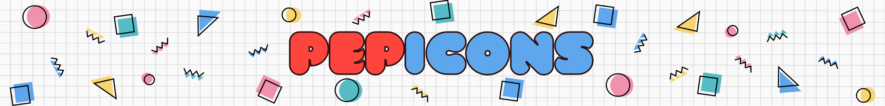

# 🥤 Pepicons

<a href="https://www.npmjs.com/package/pepicons"></a>
<a href="https://www.npmjs.com/package/pepicons"></a>

Pepicons is an icon-set of around five hundred (and counting) retro icons inspired by the 80's.
Every icon available in 2 variants: Pop! and Print ❏

## Website & icons

[pepicons.cycraft.co](https://pepicons.cycraft.co)

## pepicons (TypeScript & SVGs)

See [packages/pepicons](/packages/pepicons)

## @pepicons/vue (Vue 3)

See [packages/vue](/packages/vue)

## Motivation

Check out this blog post to understand our motivation for creating Pepicons:

- English: [Pepicons: Retro Icon Set now available for Designers and Coders](https://lucaban.medium.com/pepicons-retro-icon-set-now-available-for-designers-and-coders-40db866a7460)
- Japanese: [Pepicons: 80 年代好きにはたまらないアイコンセットが登場](https://lucaban.medium.com/pepicons-80年代好きにはたまらないアイコンセットが登場-6e417dcf4a7f)

## Contribution

In order to do anything you'll need to build the repo once:

```
npm i
npm run build
```

Then you can run the dev server:

```
npm run dev
```

Check Package.json for more scripts.

## License

Pepicons is free to use, including commercially, under CC BY 4.0. If it helps you earn money, please consider [sponsoring its development](https://github.com/sponsors/mesqueeb).

This icon set falls under CREATIVE COMMONS ATTRIBUTION 4.0 INTERNATIONAL LICENSE.

You must give appropriate credit, provide a link to the license, and indicate if changes were made. You may do so in any reasonable manner, but not in any way that suggests the licensor endorses you or your use.

See the full LICENSE details at [LICENSE](LICENSE).
